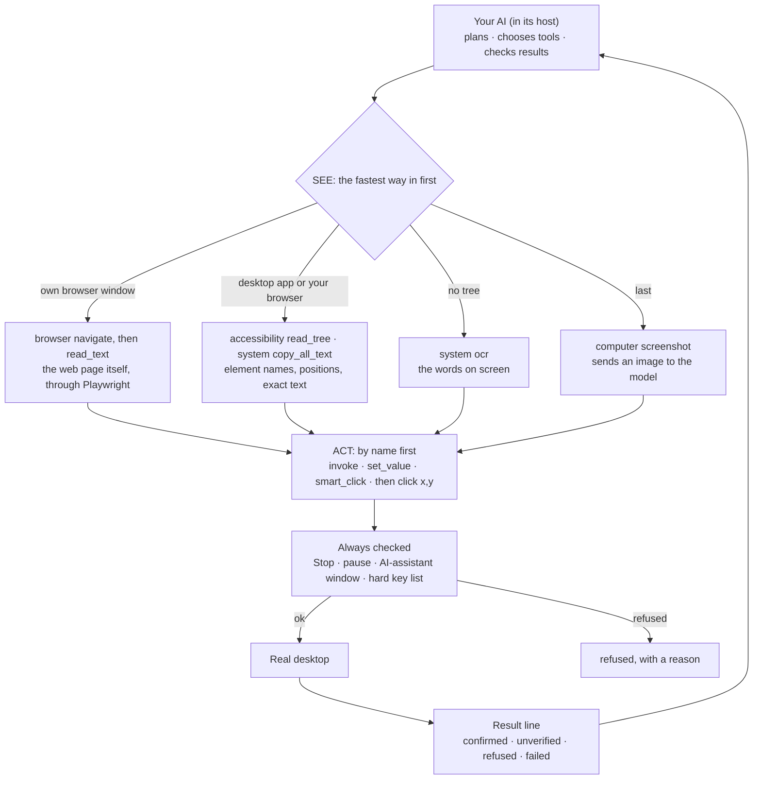

<h1 align="center">Clawd Cursor</h1>

<p align="center">
  <strong>Lets AI use your computer in real time.</strong><br>
  clawdcursor picks the fastest way into each app: the page itself in browsers, the accessibility tree in desktop apps, text recognition when there's no tree, and screenshots last. After every action it tells your AI whether it worked.
</p>

<p align="center">
  <a href="LICENSE"></a>
  <a href="https://github.com/AmrDab/clawdcursor/releases/latest"></a>
  <a href="https://www.npmjs.com/package/clawdcursor"></a>
  
  
  <a href="https://glama.ai/mcp/servers/AmrDab/clawdcursor"></a>
  <a href="https://github.com/AmrDab/clawdcursor/actions/workflows/cross-platform.yml"></a>
  <a href="https://discord.gg/hW29nrEZ8G"></a>
</p>

<p align="center">
  <a href="#what-it-does">What it does</a> &middot;
  <a href="#proof">Proof</a> &middot;
  <a href="#how-it-works">How it works</a> &middot;
  <a href="#limits">Limits</a> &middot;
  <a href="#what-protects-you">What protects you</a> &middot;
  <a href="#error-reports">Error reports</a> &middot;
  <a href="#install">Install</a> &middot;
  <a href="CHANGELOG.md">Changelog</a>
</p>

---

## What it does

Clawd Cursor is a free, open-source (MIT) MCP server. Your AI (Claude, Codex, Cursor, a local model, any MCP client) connects to it and gets six tools to use a real Windows, macOS or Linux computer: `accessibility`, `system`, `window`, `browser`, `computer` and `batch`.

It sees the parts of an app by name, through the same data screen readers use: "Email field", "Confirm button". Your AI acts on those parts by name: type into Email, press Confirm, choose High. After each change Clawd Cursor reads the result back and reports `confirmed`, `unverified` or `failed`. Text is read exactly.

Clawd Cursor has no model and no API key of its own: your AI makes every decision. Use it for the steps that only exist in a GUI. If an API, a command-line tool or a file edit does the job, use that instead.

---

## Proof

Our own benchmark: the Codex agent on Windows, 15 tasks.

| Measure | Result |
|---|---|
| Tasks done | 14 of 15 |
| Acted by name | about 100% where the app has an accessibility tree |
| Within the call budget | 12 of 15 |
| Screenshots | 4 in total, all on the two drawing-canvas tasks (the fewest those tasks allow) |
| Loops | 0 |
| False "ok" | 1 found (an action reported as done that was not): fixed on main, ships in the next release |

The scope is narrow: one OS, one agent, 15 tasks we built for the test. macOS, Linux and other models are not measured yet. From 2.1 the same benchmark runs on all three systems with several models, and a release ships only when it passes. How it measures: [bench/README.md](bench/README.md).

---

## How it works

Your AI tries these in order and uses the first that works. Your AI makes every decision; Clawd Cursor carries it out and checks it.

1. **The page itself, in Clawd Cursor's own browser window.** `browser navigate` opens Chrome or Edge with its own profile and connects to it through Playwright; your AI then reads and clicks the page from the inside. A page already open in your own browser is read through the accessibility tree.
2. **The accessibility tree, in desktop apps and your own browser.** Apps list their buttons, fields and menus by name for screen readers. Clawd Cursor reads that list and acts on each part by name.
3. **Text recognition (OCR), when there is no tree.** It reads the words on the screen and can click a visible label.
4. **Screenshots, last.** Only when nothing else works, such as on drawing canvases and 3D views.

After every action the result ends with one status line: `confirmed` (it saw the change), `unverified` (nothing could check it), `refused` (a protection stopped it) or `failed` (with a code and the next call to try). Pass `expect` on an action that matters: the call re-reads the screen and reports a `DEVIATION` if the expected state is not there.



In tool terms:

- **See.** `accessibility read_tree` lists a window's parts by name, `system copy_all_text` gives the exact text of a page or document, and `system ocr` reads the screen when the tree is empty. `computer screenshot` and its variants (`screenshot_region`, `zoom`) come last: they are the only reads that put an image in the model's context. On a page your AI opened with `browser navigate`, `browser read_text` reads the page itself.
- **Act.** `accessibility invoke` clicks a part by name and `set_value` fills a field. If the name is not in the tree, `smart_click` finds the visible label by OCR. `compile_ui`, `find_button` and `find_field` return an `{element_id, snapshot_id}` pair that stays valid when the layout shifts. A click at a screen position is for a target with no name and no visible text.
- **Keys.** The server tells your AI which OS it is on. `mod` means `cmd` on macOS and `ctrl` on Windows and Linux.

### The words, in plain terms

- **MCP** (Model Context Protocol): the standard way to plug tools into an AI app. Clawd Cursor is the tool side; your AI app connects to it.
- **Accessibility tree:** the list of buttons, fields and menus an app gives the system, each with a name. Screen readers for blind people use the same list.
- **Acting by name:** pressing "Send" because it is called Send, not because it sits at a spot on the screen.
- **OCR:** text recognition, reading the words in a picture of the screen. It runs on your computer.
- **Playwright and CDP:** Playwright is a library that controls Chrome and Edge from the inside, over the Chrome DevTools Protocol (CDP), the browser's own debugging connection. Apps built on a browser engine (Electron or WebView2) can be reached the same way; `system detect_webview` finds them.
- **Compact tools:** the six tools your AI sees with `--compact`. Without it there are 89 smaller tools, one per action. See [The tools](#the-tools).
- **The pill and the outline:** while your AI is working, a pill on screen says what it is doing ("Typing in Edge") and a 3 px outline marks the window it is working in: amber while it works, blue while it waits for you. Nothing is drawn over the window's content.
- **The pause card:** for a sign-in or a 2FA code, your AI calls `system pause_for_user`. A card on screen says what is needed and can offer choices or a text box. Your AI continues when you click Resume, or as soon as its `done_when` condition shows on screen.

---

## Limits

- It depends on apps exposing accessibility info. Most do: web pages, native apps, Office and system dialogs.
- Apps that draw their own screen (drawing canvases, games, CAD viewports) have no named parts. There it needs OCR or screenshots.
- The benchmark covers Windows and one agent so far. macOS and Linux are supported but not benchmarked yet.
- It acts with your permissions, and it has no built-in policy engine: see [What protects you](#what-protects-you).

---

## What protects you

Clawd Cursor runs with **your own OS permissions**: anything you can do with a mouse and a keyboard, your AI can do through it.

What is enforced, whatever your AI sends:

- **A Stop button.** Press Stop on the pill (or double-click it), or run `clawdcursor stop`. Every Clawd Cursor process stops, including a call or batch already running, and stays stopped across restarts until you resume.
- **An outline around the window being worked on**, amber while your AI works and blue while it waits for you.
- **The pause card.** For a sign-in or a 2FA code your AI hands that one step to you. While the card is up, no other tool call runs. A choice or a typed reply on the card comes only from you: your AI cannot click its own card or the pill. On the granular surface an agent can also end a pause with `resume_task`; that is reported as unverified, never as your answer.
- **No typing into AI assistant windows.** Input is refused when the window in front is an AI assistant your AI did not focus or open on purpose, or is no longer the window it was working in.
- **Password values are never read.** Password field values are never returned by tree, find or value reads on Windows and macOS (Linux from the next release). A screenshot or OCR can still show whatever is visible on screen.
- **A short list of keys that are never sent**, because they lock the machine or end the session. Windows: `Win+L`, `Ctrl+Alt+Del`. macOS: `Ctrl+Cmd+Q`, `Cmd+Shift+Q`, anything with Power or Eject. Linux: `Super+L`, `Ctrl+Alt+Del`, `Ctrl+Alt+Backspace`, `Ctrl+Alt+F1`&ndash;`F12`, SysRq, Power. Every other shortcut is allowed.
- **Local only, with a token.** `clawdcursor agent` binds `127.0.0.1` only and requires the bearer token. `clawdcursor mcp` (stdio) opens no port.
- **Screen text is marked as data.** Page text, OCR, the clipboard, titles and element names reach your AI inside `<untrusted-screen-content>` or quoted, and cannot break out of that wrapping. Whether the model obeys text it reads is the model's and the host's side of prompt-injection defence.
- **One-time consent.** No tool runs until you accept once.

What is not enforced by Clawd Cursor:

- **There is no built-in policy engine.** Clawd Cursor does not decide which actions your AI may take, and nothing is refused for being "destructive". Your AI and your MCP host's approval prompts decide. (The policy gate of 1.x was removed in 2.0 because a click by coordinates went around it.)
- **Per-action approval is your host's job.** The tools carry `readOnlyHint` / `destructiveHint` annotations for hosts that prompt. Approving a Clawd Cursor tool in a host means approving desktop control with your rights, not one narrow action. On the compact surface all six tools are marked destructive, because each covers many actions; the granular surface has one hint per action.
- **If your host auto-approves tool calls, nothing asks before an irreversible action.** Your AI is instructed to ask on the pause card before sending, deleting, paying or closing unsaved work that you did not ask for, but that is an instruction, not a check. For agents you do not fully trust, or for unattended runs, use a host with approval prompts. An opt-in confirm mode is coming in 2.1 ([#373](https://github.com/AmrDab/clawdcursor/issues/373)).
- **An agent with its own shell** on your machine is not confined by Clawd Cursor at all.

Privacy:

- **No model calls.** Screenshots and screen text go only to the MCP client that asked for them. `clawdcursor report` is opt-in and previews what it sends. For the error reports that start in 2.1, see [Error reports](#error-reports).
- **No screenshots, if you want.** `clawdcursor agent --no-vision`, or `CLAWD_DISABLE_VISION=1` (which also covers stdio), refuses every call that would return an image; your AI works from the accessibility tree and OCR text.
- **Logs.** `~/.clawdcursor/logs/` records which tool ran and whether it worked, not typed text or screen content.
- **Pauses.** A pause times out after 15 minutes (`CLAWD_PAUSE_TIMEOUT_MIN`). `CLAWD_NO_PAUSE=1` turns pausing off for CI and unattended runs.

[SECURITY.md](SECURITY.md) has the threat model, the limits of each guarantee, and how to report a vulnerability privately.

---

## Error reports

2.0.0 sends nothing. **From 2.1**, Clawd Cursor sends anonymous error reports by default, so bugs get found and fixed.

- **Sent with every report:** a random install id made on your computer, the Clawd Cursor version and your OS.
- **Sent when the server starts:** OS version, CPU type, Node.js version, which AI app started it (from a fixed list: Claude Code, Cursor, Codex and others; anything else is "other"), and compact or granular tools.
- **Sent when a call fails or takes over 10 seconds:** the tool and action name, the result code, how long it took, and whether the app was a browser, an Electron app or a native app.
- **Sent on a crash or exit:** the error type or the exit reason (from a fixed list), and the file and line in Clawd Cursor's own code.
- **Never sent:** error text, screen or OCR text, typed text, the clipboard, window titles, URLs, element names, the names of the apps your AI works in, file paths outside Clawd Cursor, user names or emails. No IP address is stored.
- **To turn them off:** run `clawdcursor optout`, or ask your AI to opt out for you (it calls `system telemetry_optout`).

From 2.1, `clawdcursor telemetry` prints the status and every field it sends.

---

## Install

Pick your host. Each one needs the one-time desktop-control consent, and on macOS the Accessibility and Screen Recording permissions ([macOS setup](docs/MACOS-SETUP.md)).

### Claude Code: the plugin

```bash
claude plugin marketplace add AmrDab/clawdcursor
claude plugin install clawdcursor@clawdcursor
```

The plugin registers the MCP server (through `npx`, so no separate install; Node.js 20+ required) and bundles the usage skill. The first tool call asks "Allow clawdcursor to control this computer" in the app.

### Claude Desktop: the .mcpb extension

Download the extension for your OS from the [latest GitHub release](https://github.com/AmrDab/clawdcursor/releases/latest) and open it:

| Windows | macOS | Linux |
|---|---|---|
| [clawdcursor-win32.mcpb](https://github.com/AmrDab/clawdcursor/releases/latest/download/clawdcursor-win32.mcpb) | [clawdcursor-darwin.mcpb](https://github.com/AmrDab/clawdcursor/releases/latest/download/clawdcursor-darwin.mcpb) | [clawdcursor-linux.mcpb](https://github.com/AmrDab/clawdcursor/releases/latest/download/clawdcursor-linux.mcpb) |

1. Double-click the file, or use **Settings → Extensions → Advanced settings → Install Extension…**.
2. Turn on **Allow clawdcursor to control this computer**. That is the consent; until it is on, every tool returns a consent prompt.
3. **macOS:** when asked, allow Claude under **Privacy & Security → Accessibility** and **Screen Recording**.

No Node.js, npm or JSON editing: Claude Desktop runs the bundled server.

### Codex, Cursor and other MCP hosts: `clawdcursor mcp --compact`

Install once:

```bash
npm i -g clawdcursor            # Node.js 20+
clawdcursor consent --accept    # one-time desktop-control consent
clawdcursor grant               # macOS only: Accessibility + Screen Recording
```

Then register a stdio server whose command is `clawdcursor mcp --compact`. The host starts it; you never run it yourself. Only the config shape differs:

**OpenAI Codex** (`~/.codex/config.toml`; the first launch can take a few seconds, so raise the 10 s startup timeout):
```toml
[mcp_servers.clawdcursor]
command = "clawdcursor"
args = ["mcp", "--compact"]
startup_timeout_sec = 30
```

**Cursor, Windsurf, Cline, Gemini CLI, Claude Desktop without the extension** (`mcpServers`):
```json
{
  "mcpServers": {
    "clawdcursor": { "command": "clawdcursor", "args": ["mcp", "--compact"] }
  }
}
```

**VS Code (Copilot)** (`.vscode/mcp.json` uses `servers`, not `mcpServers`):
```json
{
  "servers": {
    "clawdcursor": { "command": "clawdcursor", "args": ["mcp", "--compact"] }
  }
}
```

**Zed** (`context_servers` in `settings.json`):
```json
{
  "context_servers": {
    "clawdcursor": { "command": "clawdcursor", "args": ["mcp", "--compact"] }
  }
}
```

**opencode** (`opencode.json` uses `mcp`, and `command` is an array):
```json
{
  "mcp": {
    "clawdcursor": { "type": "local", "command": ["clawdcursor", "mcp", "--compact"] }
  }
}
```

**Claude Code without the plugin:**
```bash
claude mcp add clawdcursor -s user -- clawdcursor mcp --compact
```

One-click for Cursor and VS Code (these use `npx`, no global install):

[](https://cursor.com/install-mcp?name=clawdcursor&config=eyJjb21tYW5kIjoibnB4IiwiYXJncyI6WyIteSIsImNsYXdkY3Vyc29yIiwibWNwIiwiLS1jb21wYWN0Il19)
[](https://vscode.dev/redirect/mcp/install?name=clawdcursor&config=%7B%22name%22%3A%22clawdcursor%22%2C%22command%22%3A%22npx%22%2C%22args%22%3A%5B%22-y%22%2C%22clawdcursor%22%2C%22mcp%22%2C%22--compact%22%5D%7D)

Notes:

- **No global install:** use `npx` as the command with args `-y clawdcursor mcp --compact`. A global install is still the better choice for a tool with desktop control: the version is pinned and on disk, and on macOS the native helper is built at install time.
- **Windows:** some hosts start the server without a shell and cannot find `clawdcursor` or `npx` (both are `.cmd` shims). If the server does not start, wrap it: `"command": "cmd", "args": ["/c", "clawdcursor", "mcp", "--compact"]`.
- **Consent in the app:** hosts that support MCP elicitation (Claude Code, VS Code) ask for consent on the first tool call, so `consent --accept` can be skipped there.
- **Per-OS requirements.** Windows: none. macOS: Xcode Command Line Tools (`xcode-select --install`) to build the native helper. Linux: `tesseract-ocr` (OCR), `python3-gi` and `gir1.2-atspi-2.0` (accessibility tree), and on Wayland `ydotool`.
- **Permission allowlists:** use the server-level wildcard `mcp__clawdcursor`, not per-tool entries.

<details>
<summary>Installer scripts (they run <code>npm i -g clawdcursor</code> after checking Node and PATH)</summary>

```powershell
# Windows (PowerShell)
powershell -c "irm https://clawdcursor.com/install.ps1 | iex"
```
```bash
# macOS / Linux
curl -fsSL https://clawdcursor.com/install.sh | bash
```
</details>

### Over HTTP: `clawdcursor agent`

For an agent that speaks MCP over HTTP (a headless process, the Agent SDK, your own loop):

```bash
clawdcursor agent --compact     # HTTP MCP on 127.0.0.1:3847/mcp
```

Every request needs the bearer token in `~/.clawdcursor/token`. The server binds to `127.0.0.1` only; to reach it from another machine, tunnel the port over SSH (`ssh -L 3847:127.0.0.1:3847 user@host`).

```bash
# List the tools. The Accept header is required by MCP's Streamable HTTP transport.
curl -s -X POST http://127.0.0.1:3847/mcp \
  -H "Authorization: Bearer $(cat ~/.clawdcursor/token)" \
  -H "Content-Type: application/json" \
  -H "Accept: application/json, text/event-stream" \
  -d '{"jsonrpc":"2.0","id":1,"method":"tools/list"}'
```

```powershell
# Windows PowerShell 5.1
$token = (Get-Content "$env:USERPROFILE\.clawdcursor\token" -Raw).Trim()
$headers = @{ Authorization = "Bearer $token"; Accept = "application/json, text/event-stream" }
$body = '{"jsonrpc":"2.0","id":1,"method":"tools/list"}'
Invoke-RestMethod -Method Post -Uri http://127.0.0.1:3847/mcp -Headers $headers -ContentType "application/json" -Body $body
```

### Updating

| Installed as | Update with |
|---|---|
| Global npm package | `npm i -g clawdcursor@latest` |
| Claude Desktop extension | Download the new `.mcpb` from the [latest release](https://github.com/AmrDab/clawdcursor/releases/latest) and open it |
| Claude Code plugin | `claude plugin marketplace update clawdcursor`, then `claude plugin update clawdcursor@clawdcursor` |

Restart the host afterwards so it starts the new server. `clawdcursor versions` lists every copy on the machine and its version. A single `clawdcursor update` command is planned for 2.1.

**Coming from 1.x:** remove calls to the `task` tool and to `clawdcursor task`, drop the `--provider`, `--model`, `--base-url` and `--api-key` flags and the `AI_API_KEY` / `CLAWD_*_MODEL` variables, and configure the model in your agent host. Old config files still load; the model keys in them are ignored.

---

## What's new

**2.0.0** &mdash; **A tool, driven by your agent.** First published as 1.6.0 and renumbered because it is a breaking change; 1.6.0 is deprecated on npm. ([full changelog](CHANGELOG.md))
- **Breaking:** the built-in agent loop and all model settings are gone. The `task` tool, `clawdcursor task`, the scheduler and the `--provider` / `--model` / `--api-key` flags are removed, and `clawdcursor doctor` is a diagnostic only. Your agent calls the six tools step by step, or `batch` for a known sequence.
- **Breaking:** the policy gate is gone: no tiers, no "confirm", nothing refused by label. See [What protects you](#what-protects-you) for what is still enforced, and what is not.
- A thin outline around the window the agent is working in replaces the full-screen glow.
- Keys follow the OS: the agent is told its modifier (`cmd` or `ctrl`) up front, `mod` means that modifier, and shortcuts are offered only for this OS.
- Screen text that reaches the agent cannot close its `<untrusted-screen-content>` block, and `open_app` only starts an installed app by name.

**1.5.27** &mdash; Ticks, dropdowns and expanders read and change the same way on all three OSes; a stop also blocks hover, clipboard writes, page script and tab switches; logs in `~/.clawdcursor/logs/` record each call's timing and outcome without typed text or window titles.

Earlier releases are in the [changelog](CHANGELOG.md).

**Next: 2.1.** One standard benchmark across app types, OSes and models becomes the release gate, with five general mechanisms behind it: honest results, target resolution, perception without a tree, screen geometry and timing. An opt-in confirm mode ([#373](https://github.com/AmrDab/clawdcursor/issues/373)) and `clawdcursor update` are planned for the same release. See the [2.1 milestone](https://github.com/AmrDab/clawdcursor/milestone/1).

---

## The tools

Two surfaces run the same code behind the same guards.

- **Compact** (`--compact`, recommended): six tools, each with an `action` parameter. About 7,000 tokens of `tools/list`.
- **Granular** (the default without `--compact`): 89 tools, one per action. About 19,000 tokens. Use it when a runtime needs every primitive as its own tool, or when you want your host to prompt per kind of action.

(Token figures are the `tools/list` JSON of 2.0.0, characters ÷ 3.5.)

| Tool | Actions |
|---|---|
| `accessibility` | `read_tree`, `find`, `get_element`, `focused`, `invoke`, `focus`, `set_value`, `get_value`, `expand`, `collapse`, `toggle`, `select`, `state`, `list_children`, `wait_for`, `compile_ui`, `find_button`, `find_field`, `smart_click`, `smart_type`, `smart_read` |
| `system` | `clipboard_read`, `clipboard_write`, `copy_all_text`, `report`, `system_time`, `ocr`, `undo`, `shortcuts_list`, `shortcuts_run`, `pause_for_user`, `detect_webview`, `relaunch_with_cdp`, `build_uri`, `open_uri`, `open_app`, `open_file`, `open_url` |
| `window` | `list`, `active`, `focus`, `maximize`, `minimize`, `restore`, `close`, `resize`, `list_displays`, `screen_size`, `open_app`, `open_file`, `open_url`, `switch_tab`, `navigate` |
| `browser` | `navigate`, `connect`, `page_context`, `read_text`, `click`, `type`, `select_option`, `evaluate`, `wait_for`, `list_tabs`, `switch_tab`, `scroll` |
| `computer` | `click`, `double_click`, `right_click`, `middle_click`, `triple_click`, `hover`, `move`, `move_relative`, `scroll`, `scroll_horizontal`, `drag`, `drag_path`, `mouse_down`, `mouse_up`, `type`, `key`, `key_press`, `key_down`, `key_up`, `wait`, `screenshot`, `screenshot_region`, `zoom` |
| `batch` | `{steps:[…]}`: several calls in one round trip. Each step is `{name, arguments, expect?}` and is refused exactly as a direct call would be; the batch halts with a per-step trace on a refusal, an error or a failed `expect`. |

```js
accessibility({ action: "invoke", name: "Send" })    // click by name
computer({ action: "key", combo: "mod+s" })          // Cmd+S on macOS, Ctrl+S elsewhere
window({ action: "open_app", name: "Outlook" })
```

The full guide for agents is [SKILL.md](SKILL.md); it ships in the npm package and the Claude Code plugin. [clawdcursor.com/llms.txt](https://clawdcursor.com/llms.txt) is a shorter summary of it: install, the tool surface and the safety rules. Every parameter is in [schema.snapshot.json](schema.snapshot.json).

---

## Platform support

| Platform | UI tree | OCR | Browser (CDP) | Input |
|---|---|---|---|---|
| **Windows** 10/11 (x64 / ARM64) | UI Automation via a PowerShell bridge | `Windows.Media.Ocr` | Chrome / Edge | nut-js |
| **macOS** 12+ (Intel / Apple Silicon) | Native AX helper (Swift), JXA fallback | Apple Vision | Chrome / Edge | nut-js + System Events |
| **Linux** X11 | AT-SPI via `python3-gi` | Tesseract | Chrome / Edge | nut-js |
| **Linux** Wayland | AT-SPI via `python3-gi` | Tesseract | Chrome / Edge | `ydotool` / `wtype` |

- **Windows:** no setup.
- **macOS:** Accessibility is required; Screen Recording is needed only for screenshots and OCR. `clawdcursor grant` opens the dialogs. See [docs/MACOS-SETUP.md](docs/MACOS-SETUP.md). Retina scaling is handled for you: do not pre-scale coordinates.
- **Linux X11:** `sudo apt install tesseract-ocr python3-gi gir1.2-atspi-2.0`.
- **Linux Wayland:** the same, plus `ydotool` with `ydotoold` (preferred) or `wtype` (keyboard only).

---

## CLI

For people setting up or diagnosing an install. Agents connect over MCP.

```
clawdcursor consent         Desktop-control consent (--accept / --revoke / --status)
clawdcursor grant           Request macOS permissions (macOS only)
clawdcursor mcp             stdio MCP server; your host starts this (--compact for the six tools)
clawdcursor agent           HTTP MCP server on 127.0.0.1:3847 (--port, --compact, --no-vision)
clawdcursor stop            Stop every running instance; agents stay stopped until resume
clawdcursor resume          Continue a paused task or give control back after a stop (--end to end the task)
clawdcursor doctor          Diagnose the install (version, consent, screen capture, accessibility, permissions)
clawdcursor status          Readiness check (consent, permissions)
clawdcursor versions        Every installed copy and its version
clawdcursor report          Send a redacted report of the last session, after a preview (--save-only)
clawdcursor register-skill  Register the usage skill in detected agents again
clawdcursor uninstall       Remove all config, data and skill registrations
```

`--no-banner` (or `CLAWD_NO_BANNER=1`) on `mcp` and `agent` turns the on-screen pill and outline off.

---

## Development

```bash
git clone https://github.com/AmrDab/clawdcursor.git && cd clawdcursor
npm install
npm run build       # tsc + postbuild + bundle  ->  dist/surface/cli.js
npm test            # vitest
npm run lint        # eslint
npm link            # global `clawdcursor` shim
```

| Directory | What lives here |
|---|---|
| `src/core/` | Reading the screen (accessibility snapshots, the UI compiler), verification, and the Stop / pause / AI-assistant guards. |
| `src/tools/` | The granular tools, the five compound tools and `batch`. |
| `src/platform/` | The `PlatformAdapter` for Windows, macOS, Linux and Wayland; OCR; the CDP driver; the hard key list. |
| `src/surface/` | CLI, MCP server (stdio and HTTP), dashboard, doctor, consent. |

CI runs the tests on Node 20 and 22 on Ubuntu, macOS and Windows, with a coverage threshold, a performance smoke test and an `npm audit` gate.

## Contributing

See [CONTRIBUTING.md](CONTRIBUTING.md). Bugs and feature requests go in [issues](https://github.com/AmrDab/clawdcursor/issues); security reports go through [SECURITY.md](SECURITY.md).

## License

MIT. See [LICENSE](LICENSE).

## Acknowledgments

Built on the Model Context Protocol SDK, nut-js, Playwright, sharp, and the AT-SPI, UI Automation and AX accessibility APIs.

---

<p align="center">
  <a href="https://clawdcursor.com">clawdcursor.com</a> &middot;
  <a href="https://discord.gg/hW29nrEZ8G">Discord</a> &middot;
  <a href="CHANGELOG.md">Changelog</a> &middot;
  <a href="https://www.npmjs.com/package/clawdcursor">npm</a>
</p>
